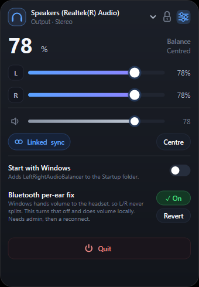

# Left Right Audio Balancer

[](https://github.com/srnafi/left-right-audio-balancer/actions/workflows/ci.yml)

Balancing left and right audio on Windows is a pain. The setting exists,
but it is buried several dialogs deep in Control Panel, behind tabs most
people never open. When one ear is louder than the other, fixing it means
finding that panel again, every time.

This app puts both channels on a small card you keep on the desktop: two
sliders, one per ear, plus a master that scales both without breaking the
balance you set.


It also fixes the reason per-ear control is often missing. Many Bluetooth
headsets take volume over AVRCP absolute volume, so Windows hands the level to
the headset and the endpoint reports a single channel. There is nothing to
split. The app can turn absolute volume off, which makes Windows own the level
locally and gives you the left and right channels back.

## Install

Download `LeftRightAudioBalancer.exe` from the
[latest release](https://github.com/srnafi/left-right-audio-balancer/releases/latest)
and run it. It is a standalone 390 KB native binary with no external runtime dependencies.

The card opens in the bottom-right corner of the desktop the first time. Once
you drag it somewhere, it comes back there on the next start. Right-click it to
quit, or use **Quit** in the settings drawer.

## Performance

The app was rewritten in native C++ with Direct2D to keep resource usage negligible:
- Working set memory sits at roughly 0.8 MB (down from 100 MB to 250 MB in the original WPF build).
- The executable is 394 KB, down from a 75 MB self-contained .NET bundle.
- It idles at 0% CPU, using hardware acceleration only when repainting or animating.

## Using it

Pick your output device from the dropdown at the top. It shows what kind of
device it is under the name, and swaps in a Bluetooth glyph when the endpoint
is wireless. The sliders below show that device's left and right volume.

**Linked** is on by default. Dragging either slider moves the other by the same
amount, so the offset between the ears stays put. The footer shows that offset:
`R -12` means the right ear is twelve points below the left. Turn Linked off to
move each ear independently. **Centre** sets both to their average.

**VOL** is the master. It never goes below the loudest ear, and moving it
rescales both channels by the same ratio, so your balance survives.

Each ear slider carries a live level meter: the bright bar inside the fill
tracks what is actually coming out of that channel, so you can tell whether a
quiet side is the setting or the audio.

The **padlock** in the header locks the card in place. While it is locked the
card cannot be dragged, but every control still works, so clicking a slider
cannot move the whole window by accident. The lock survives a restart.

By default the card sits at the back of the desktop, out of the way of real
windows, and comes forward when you show the desktop.

## Bluetooth headsets

If a headset shows only one channel, the card says so above the sliders. On a
Bluetooth device the message carries a **Fix** button.

The fix writes `DisableAbsoluteVolume` under
`HKLM\SYSTEM\CurrentControlSet\Control\Bluetooth\Audio\AVRCP\CT`. It needs
administrator rights, so Windows will ask for permission. After it applies,
reconnect the headset or let the app restart the Bluetooth audio service.

This is a machine-wide setting. Revert it from the settings drawer if you would
rather let the headset control its own volume.

## Settings

Click the sliders icon in the header.



- **Start with Windows** adds a shortcut to your Startup folder.
- **Bluetooth per-ear fix** applies or reverts the registry value above.
- **Quit** closes the app.

Settings live in `%APPDATA%\LeftRightAudioBalancer\settings.json`. That file
holds the selected device, the lock and linked states, the start-with-Windows
flag, and the last card position.

## Build

Requires Visual Studio 2022 (MSVC) or C++ build tools.

### Via Command Line (Batch Script)
```cmd
build.bat
```

### Via CMake
```cmd
cmake -B build
cmake --build build --config Release
```

### Via Visual Studio
Open `LeftRightAudioBalancer.sln` in Visual Studio and build `Release | x64`.

## How it works

Per-ear volume is the per-channel volume of a render endpoint. Windows Core Audio
exposes it directly through `IMMDeviceEnumerator`, `IAudioEndpointVolume`, and
`IAudioMeterInformation`.

Rendering uses Direct2D on a 32-bit layered window (`UpdateLayeredWindow`), which
provides hardware-accelerated anti-aliased rounded corners without a window frame.

The level meter is polled every 16 ms. It jumps straight to a new peak and falls
back smoothly on each tick, which reads as a decay rather than a flicker.

## License

MIT
