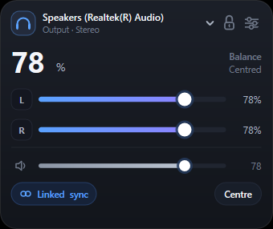

# Left Right Audio Balancer

[](https://github.com/srnafi/left-right-audio-balancer/actions/workflows/ci.yml)

Balancing left and right audio on Windows 10 is a pain. The setting exists,
but it is buried several dialogs deep in Control Panel, behind tabs most
people never open. When one ear is louder than the other, fixing it means
finding that panel again, every time.

This app puts both channels on a small card you keep on the desktop: two
sliders, one per ear, plus a master that scales both without breaking the
balance you set.



It also fixes the reason per-ear control is often missing. Many Bluetooth
headsets take volume over AVRCP absolute volume, so Windows hands the level to
the headset and the endpoint reports a single channel. There is nothing to
split. The app can turn absolute volume off, which makes Windows own the level
locally and gives you the left and right channels back.

## Install

Download `LeftRightAudioBalancer.exe` from the
[latest release](https://github.com/srnafi/left-right-audio-balancer/releases/latest)
and run it. It is a completely standalone native binary (~385 KB) with zero external runtime dependencies.

The card opens in the bottom-right corner of the desktop the first time. Once
you drag it somewhere, it comes back there on the next start. Right-click it to
quit, or use **Quit** in the settings drawer.

## Performance & Memory

Rewritten completely in **Native C++ with Direct2D & DirectWrite**, reducing resource usage drastically:
- **RAM footprint:** **~0.7 MB working set** (down from 100 MB – 250+ MB in WPF).
- **Executable size:** **~385 KB** (down from a 73 MB self-contained .NET bundle).
- **Rendering:** Hardware-accelerated 32-bit ARGB Layered Window with sub-pixel anti-aliased rounded corners across both Windows 10 and Windows 11.
- **CPU:** 0.0% at idle with reactive timers.

## Build

Requires Visual Studio 2022 (MSVC) or C++ build tools.

### Via Command Line (Batch Script)
```cmd
build.bat
```
or from `src/LeftRightAudioBalancer`:
```cmd
cd src\LeftRightAudioBalancer
build.bat
```

### Via CMake
```cmd
cmake -B build
cmake --build build --config Release
```

### Via Visual Studio
Open `LeftRightAudioBalancer.sln` or `LeftRightAudioBalancer.slnx` in Visual Studio and build `Release | x64`.


## How it works

Per-ear volume is the per-channel volume of a render endpoint. Windows Core Audio
exposes it directly through `IMMDeviceEnumerator`, `IAudioEndpointVolume`, and `IAudioMeterInformation`. Native COM interfaces are used directly with zero external audio dependencies.

Each slider's thumb is the same width as the knob it draws, with a transparent
overhang for the grab area. A wider thumb pushes the knob in from the track
ends and stops the fill at the thumb edge, which leaves a visible gap between
the line and the knob. Keep the two widths equal when restyling. The hover
halo is a separate ellipse that grows through a negative margin, so it never
changes the thumb's layout box.

The level meter is polled every 50 ms. It jumps straight to a new peak and
falls back by a fixed ratio on each tick, which reads as a decay rather than a
flicker.

## Development

The app is a WinExe, so it has no console. These flags write their result to a
file instead. They are compiled into every build, including release.

| Flag | Writes |
| --- | --- |
| `--dump <path>` | Window state, endpoint list, element geometry, visual tree |
| `--shot <path>` | PNG of the window at 2x |
| `--selftest <path>` | Master-scale check against the default endpoint |
| `--selftest-ui <path>` | Linked, unlinked, centre and master behaviour against the selected endpoint |
| `--drawer` | Opens the settings drawer before the above |
| `--chip` | Forces the warning chip before the above |
| `--opencombo` | Opens the device list before the above |
| `--select <n>` | Selects a device by list index before the above |
| `--ear <n> <value>` | Pins an ear slider for a capture without writing to the endpoint |
| `--shortcut-check <path>` | Creates the startup shortcut, reports what it points at, removes it |

`--selftest-ui` restores the device to its original levels when it finishes.

## License

MIT
